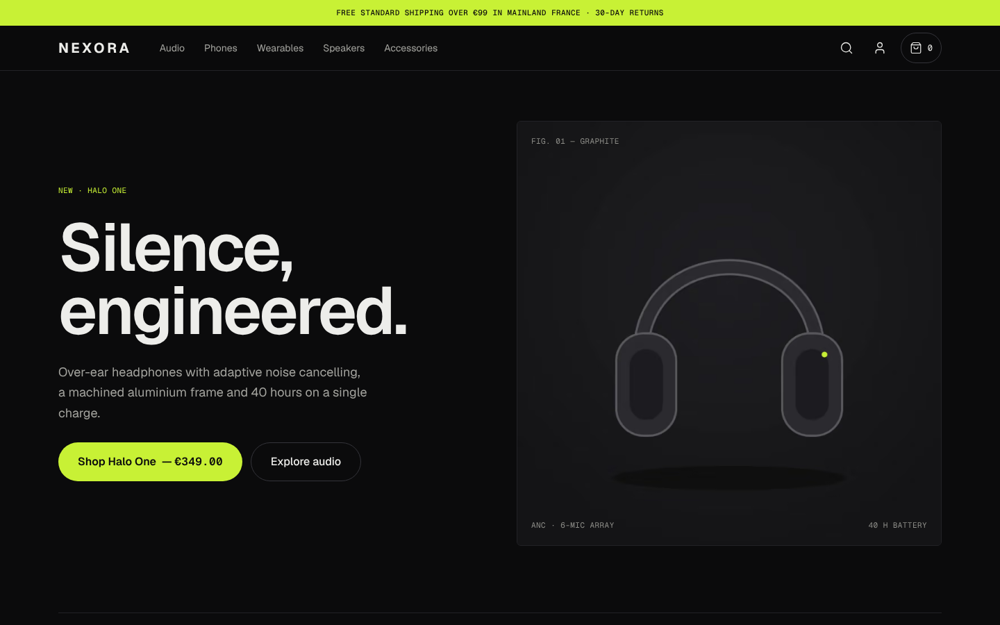
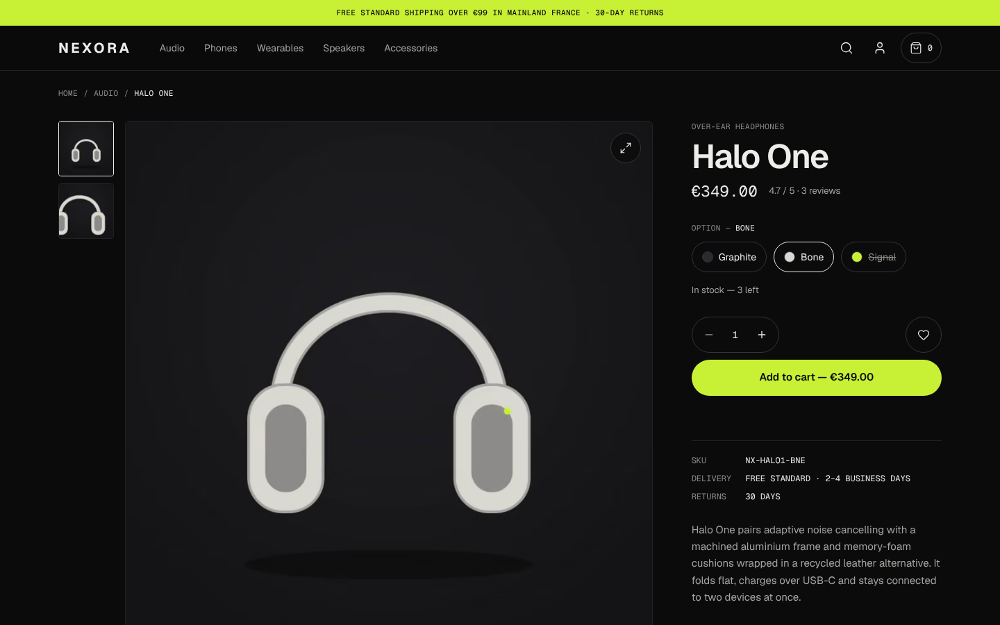
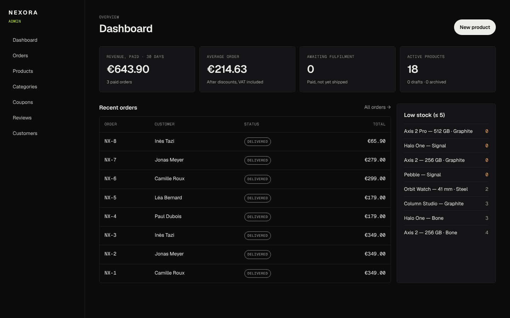
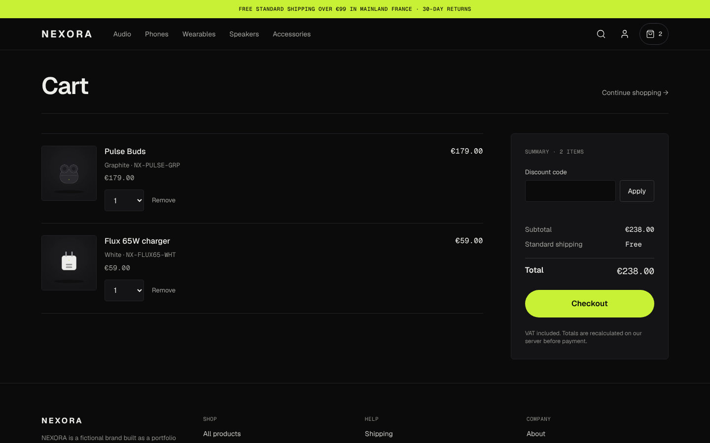
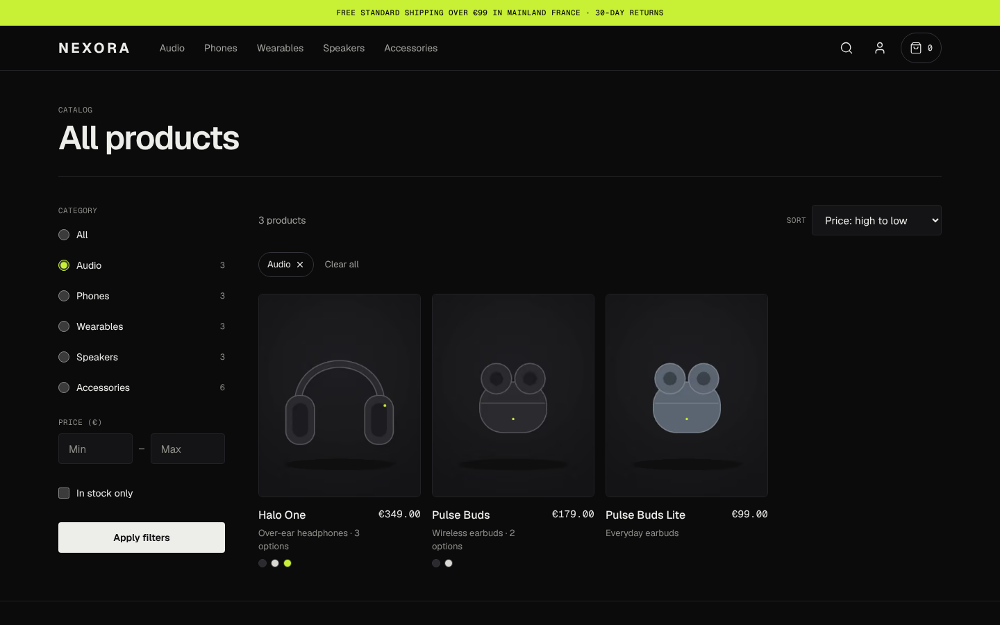

# NEXORA

A full-stack e-commerce store for a fictional electronics brand, built to the standard of a real commercial
product: server-side pricing, stock that can't be oversold, payments confirmed only by the payment provider,
accounts, an admin back office, and a test suite that proves it.



> NEXORA is a portfolio project. Products, names and specifications are fictional, product images are rendered
> from procedural 3D models written for this project, payments run in Stripe **test mode**, and nothing ships.

## What it does

| Area         | Highlights                                                                                                                                                                            |
| ------------ | ------------------------------------------------------------------------------------------------------------------------------------------------------------------------------------- |
| Storefront   | Homepage driven by catalog data, URL-based filters (category, price, stock), sorting, pagination, search with keyboard-navigable suggestions                                          |
| Product page | Variant picker synced to `?variant=`, live stock, keyboard gallery with enlarged view, specs, verified reviews, related and recently viewed products, schema.org data from real stock |
| Cart         | Guest or account cart in Postgres, quantity limits by stock, coupons validated on the server, free-shipping progress                                                                  |
| Checkout     | Address validation, delivery choice, stock reserved for 30 minutes, Stripe Checkout redirect, webhook-only payment confirmation                                                       |
| Accounts     | Sign-up/sign-in, password reset, profile, saved addresses, order history and detail, wishlist; guest cart merged on sign-in                                                           |
| Admin        | Dashboard, orders with a status state machine, products and variants, atomic stock adjustments, categories, coupons, review moderation, customer lookup, audit log                    |

|                                               |                                                |
| --------------------------------------------- | ---------------------------------------------- |
|  |  |
|             |        |

## Architecture

```
Browser ──► Next.js 16 (App Router, React 19, Server Components, Server Actions)
              │
              ├─ src/app/           routes only: read params, call a service, render
              ├─ src/components/    UI; client components only where interaction needs them
              ├─ src/server/        domain services — the only code that touches the database
              │    catalog · cart · orders · payments · admin · account · auth · session
              ├─ src/lib/           pure logic with no I/O: money, pricing, validation (zod)
              └─ prisma/            schema, migrations (incl. hand-written CHECK constraints), seed
              │
              ├──► PostgreSQL 16 (Prisma 7, driver adapter)
              └──► Stripe Checkout ──(signed webhook)──► /api/webhooks/stripe
```

A modular monolith: one deployable, with module boundaries that could become services later
([ADR-0001](docs/adr/0001-modular-monolith-nextjs.md)).

### Decisions worth reading

| ADR                                                              | Decision                                                                                                              |
| ---------------------------------------------------------------- | --------------------------------------------------------------------------------------------------------------------- |
| [0002](docs/adr/0002-money-and-order-snapshots.md)               | Money as integer cents; orders snapshot prices, names and address; Postgres CHECKs enforce totals                     |
| [0003](docs/adr/0003-stock-reservation.md)                       | Stock reserved at checkout with conditional `UPDATE … WHERE stock >= q` — tested with 8 concurrent buyers for 3 units |
| [0004](docs/adr/0004-payments-webhook-authority.md)              | Only the verified, idempotent Stripe webhook can mark an order paid                                                   |
| [0005](docs/adr/0005-auth-better-auth.md)                        | better-auth with database sessions; role never accepted from input                                                    |
| [0006](docs/adr/0006-cache-components-and-db-at-runtime.md)      | Cache Components with tagged catalog caching; the build needs no database                                             |
| [0007](docs/adr/0007-migrations-from-restricted-environments.md) | How migrations were generated where the Prisma engine couldn't be downloaded                                          |
| [0008](docs/adr/0008-procedural-product-renders.md)              | Product images rendered from procedural 3D models instead of stock or AI images                                       |

## Tech stack

Next.js 16 · React 19 · TypeScript 6 (strict) · Tailwind CSS 4 · Motion · Lucide · PostgreSQL 16 · Prisma 7 ·
better-auth · Stripe · Zod 4 · Vitest · Playwright + axe-core · Docker

## Quick start

Requirements: Node 22, pnpm 10, PostgreSQL 16.

```bash
pnpm install
cp .env.example .env            # fill in DATABASE_URL, TEST_DATABASE_URL, BETTER_AUTH_SECRET
pnpm db:migrate                 # apply migrations
pnpm db:seed                    # demo catalog, coupons, reviewers
pnpm admin:create               # first admin, password typed at a hidden prompt
pnpm dev                        # http://localhost:3000
```

Payments stay **disabled** until you add Stripe test keys (`sk_test_…`, `whsec_…`); checkout says so instead of
pretending. To test payments locally, run `stripe listen --forward-to localhost:3000/api/webhooks/stripe` and
put the printed secret in `STRIPE_WEBHOOK_SECRET`. Live keys are rejected at startup.

Demo coupons: `NEXORA10` (10%), `WELCOME15` (15% over €200, 100 uses), `AUDIO20` (€20 off audio over €100),
`SUMMER25` (expired on purpose).

## Scripts

| Command                                                         | What it does                                                   |
| --------------------------------------------------------------- | -------------------------------------------------------------- |
| `pnpm dev` / `pnpm build` / `pnpm start`                        | Develop, build, run the standalone server                      |
| `pnpm lint` / `pnpm typecheck` / `pnpm exec prettier --check .` | Static checks (warnings fail lint)                             |
| `pnpm test`                                                     | Unit + integration tests against `TEST_DATABASE_URL`           |
| `pnpm test:e2e`                                                 | Playwright on desktop and phone, with axe accessibility checks |
| `pnpm db:migrate` / `db:deploy` / `db:seed`                     | Migrations and seed                                            |
| `pnpm admin:create`                                             | Create or promote an admin                                     |
| `pnpm render:products`                                          | Re-render product images (headless Chromium, three.js)         |

## Quality

Measured, not assumed. All numbers below come from runs on 2026-10-25.

- **Unit + integration:** 79 tests across pricing, coupons, catalog queries, cart, orders, concurrency,
  webhooks, admin rules and authorization, account isolation ([docs/testing.md](docs/testing.md)).
- **End-to-end:** 20 Playwright tests against the production build, including keyboard-only purchase,
  open-redirect and IDOR checks, and axe WCAG 2.1 AA scans with zero serious/critical violations.
- **Lighthouse** (mobile emulation, local production build):

  | Page                 | Perf | A11y | Best practices | SEO | LCP   | CLS   |
  | -------------------- | ---- | ---- | -------------- | --- | ----- | ----- |
  | `/`                  | 95   | 100  | 100            | 100 | 2.9 s | 0.002 |
  | `/products`          | 90   | 100  | 100            | 100 | 3.3 s | 0.002 |
  | `/products/halo-one` | 89   | 100  | 100            | 92¹ | 2.4 s | 0.002 |

  ¹ Metadata of streamed dynamic pages is emitted in the body; see [limitations](docs/feature-report.md#known-limitations).

- **CI** runs format, lint, typecheck, migrations + drift check, seed, all tests, the e2e suite and a Docker
  build that must start without a database.

## Security

Server-side validation of all input, prices and totals recomputed on the server, ownership checks inside
every query, role checked in every admin page and action, signed and idempotent webhooks, rate limits, CSP
and security headers, no secrets in the repo. Full list and what's still missing:
[docs/security.md](docs/security.md).

## Deployment

Docker image (standalone output, non-root, read-only filesystem) plus a compose stack with Postgres and a
one-shot migration service. Step by step for a VPS behind Nginx: [docs/deployment.md](docs/deployment.md).

## Status

What's done, what's partial and what's left: [docs/feature-report.md](docs/feature-report.md).
